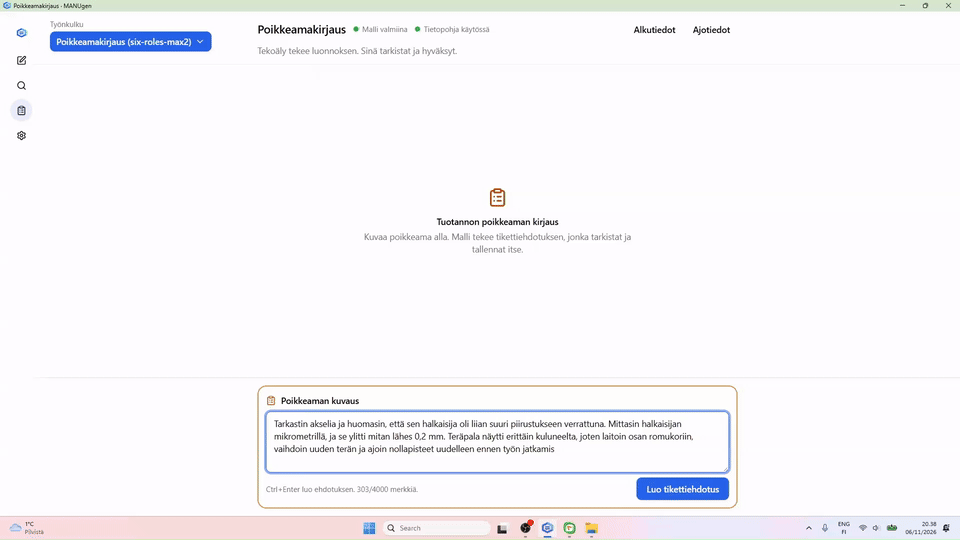
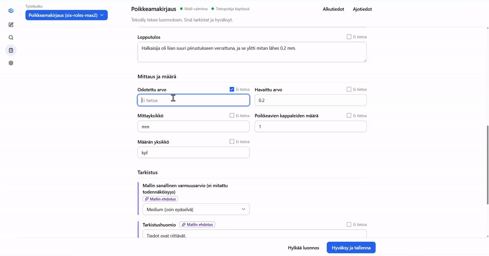
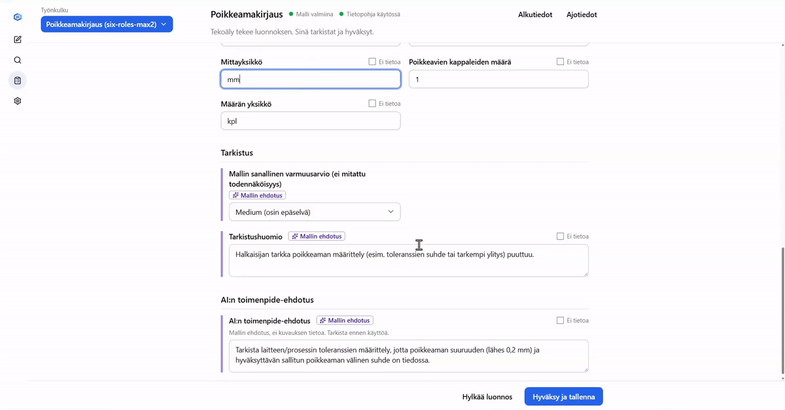
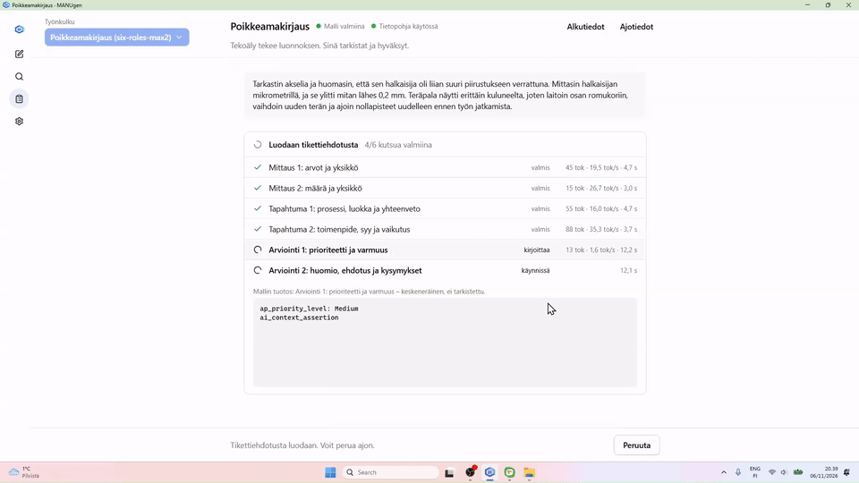
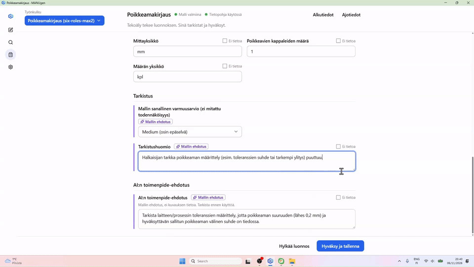
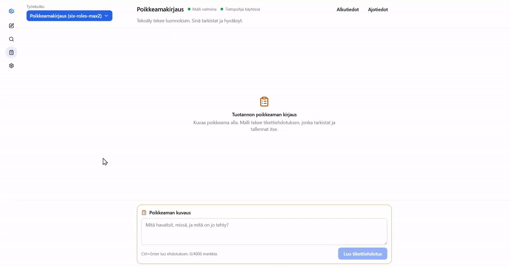
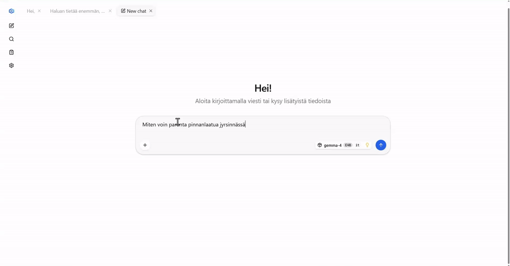
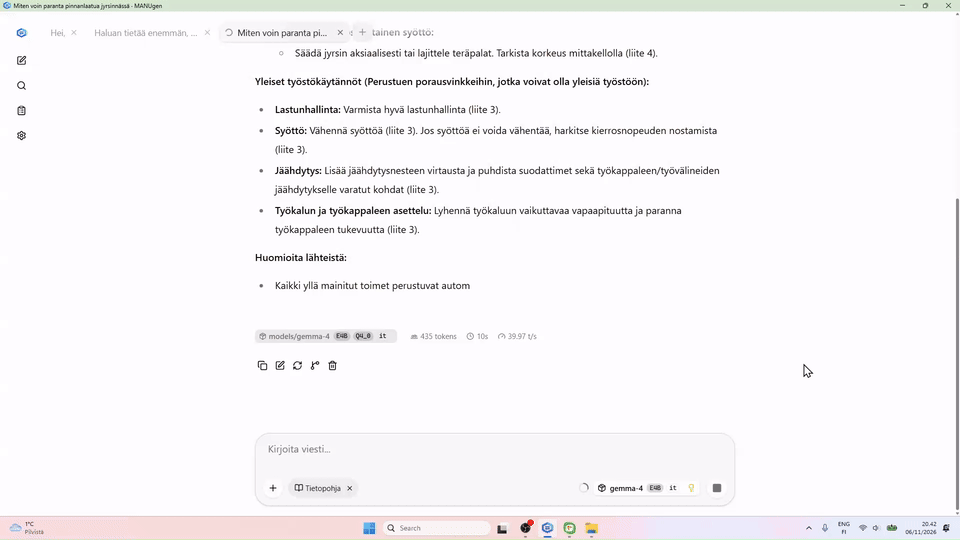
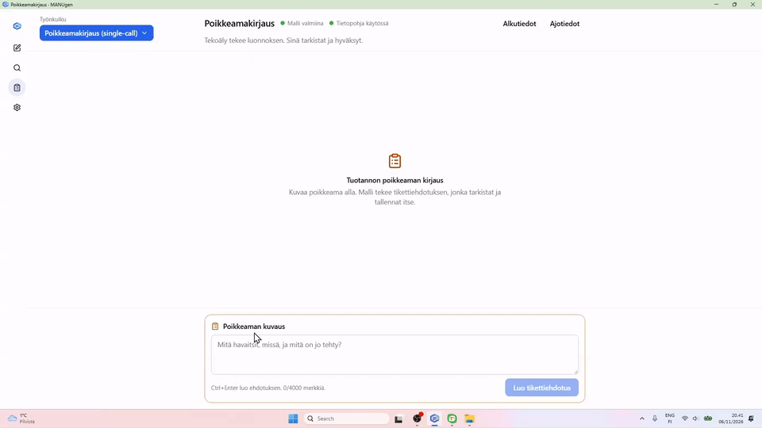

<picture></picture>

# MANUgen

A local AI assistant for manufacturing teams. A worker describes an observation in their own words. MANUgen prepares a structured draft. A person reviews, corrects and approves it. Teams can define their own workflows and fields.

**[Explore MANUgen in Finnish](https://juhanikol.github.io/manugen/)** · **[Explore MANUgen in English (condensed)](https://juhanikol.github.io/manugen/en/)** · **[Windows releases](https://github.com/juhanikol/manugen/releases)**

## Inside the application

The user works in a browser window. A local backend runs the workflow steps. A local llama.cpp server runs the language model. Nothing is sent to a cloud service. Approved records can be exported to Excel.

MANUgen was developed as part of a thesis project at Savonia University of Applied Sciences.

## Machining knowledge base

A knowledge base prepared for machining is available to the language model. It is built from Sandvik Coromant learning material and used with permission for non-commercial pilot use in the SIX Manugenius project. It is delivered on request to pilot participants as a separate package. The installer itself ships with an empty knowledge base. Terms: [licenses/content/sandvik-coromant-NOTICE.txt](licenses/content/sandvik-coromant-NOTICE.txt). Request: juhani.kolehmainen@edu.savonia.fi.

## Where to find what

| Location                                                 | Contents                                                                      |
| -------------------------------------------------------- | ----------------------------------------------------------------------------- |
| [Product site](https://juhanikol.github.io/manugen/)                                     | Finnish introduction, installation guide, examples and brand assets           |
| [Releases](https://github.com/juhanikol/manugen/releases) | Version notes, Windows installer, checksums and file manifest                 |
| [IT guide](IT-GUIDE.md)                                   | How the installation works: options, network, data, security and requirements |
| [File list](FILES.md)                                     | Every file in this repository and what it is for                              |
| [LICENSE](LICENSE)                                        | MANUgen pilot and usage terms                                                 |

This repository holds the installer script, the scripts that run on the user's computer, the default settings and the licenses. The application source code is not published.

## Features – a brief look

A day with different problems and different tools.

You start your day with problems on the shop floor. The milled parts are not as expected – they need more work. The only problem in this situation is that an even bigger task is to fill in deviation forms, figure out what to answer in each form field, explain tool usage and wear, and after all that, walk to the office to explain why the parts were not manufactured on time.

### Solution: Report in your own words

-> generate report -> verify and save -> let the people in the office read the generated report

### You can change the values if you forgot to describe all the necessary fields

### You can check what the AI offers as a solution or what it inferred from your description

### But you are unsure about the solution the AI offered, so you decide to check the reference for the suggestion

### Everything looks fine and none of the fields need changing. Just save.

### Day continues

You continue your day, and as a senior engineer you have the luxury of sitting down behind a desk. But today – as always at the end of the month – you are required to enter the handwritten shipping manifests into the system. Your manager needs them, and you have to type them in.

### Another task - another workflow - just choose which to use

Not everything can be turned into a workflow. However, all the tasks you need to perform are governed by your domain. Maybe your company has guidelines, instructions and steps to follow. Or your domain is so specialised that there is simply too much specific information, and searching for the answer to a problem is exhausting. Maybe it slipped your mind – you are sure that just yesterday you searched for the answer to the same question.

But you were smart and gave the AI all the data you use – even the sensitive guidelines. MANUgen runs in a restricted network with no internet access, or you work offline specifically for security reasons.

### Ask something about the data stored in the system

## Verify the data used

You are smart, so you also check what the references are.

Sometimes you need to go back to what you have done. Thankfully, MANUgen already feels familiar, and everything is where you expect it to be.

